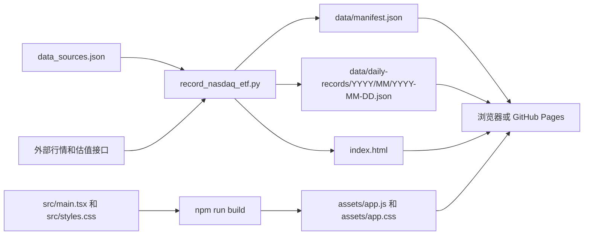

# Nasdaq ETF 跟踪项目交接文档

本文面向接手维护本项目的 Agent 或开发者。目标是让接手者不依赖历史对话，也能理解项目用途、数据口径、运行方式、更新流程和常见故障。

> **2026-09-08 变更：走势图已下线。** 页面不再展示分时走势，采集/回填流程也不抓取任何分钟数据。历史每日 JSON 中已存的 `trend` 字段原样保留、不再使用；新写入记录 `trend` 为 `null`。原「分钟走势补录与修复」章节已随功能下线删除，`--refresh-trends` 为 no-op。

> **2026-10-19 变更：取数链路改为 HTTP 多源交叉校验，`fetch_nasdaq_data.py` 成为唯一入口。**
> 早期依赖的第三方行情连接器自 2026-09 起长期不可用，继续依赖它会导致每日都需人工兜底。新脚本：
> - 自动判断 A 股是否收盘（15:00 前不记当天 ETF，只补 QQQ/NDX），自动补齐**所有**缺失交易日（含长假）；
> - ETF 收盘：新浪日 K（主）+ 腾讯日 K（校验）+ 东财 K 线（仲裁）；ETF 净值：东财官方 DWJZ（主）→ tinyright IOPV → tinyright T-1 / 指数推算；
> - QQQ/NDX：Nasdaq 官方（主）+ 新浪美股日 K（校验，NDX 用 `.NDX`），历史最高用全历史收盘序列；
> - 写入前取齐所有目标日，任一失败整体不写；写入后按中国/美国交易日历审计，缺一天即失败。
>
> `record_nasdaq_etf.py` 降级为历史脚本（仍被新脚本复用读写函数）。项目 skill：`.workbuddy/skills/nasdaq-data-completion/SKILL.md`。
> §11.2 的历史脚本命令仅供追溯，日常请以本段与 `CLAUDE.md` 为准。

## 1. 项目概览

### 1.1 项目做什么

本项目每天记录两组纳斯达克 100 跟踪数据，并生成可直接部署到 GitHub Pages 的静态页面。

第一组是三只 A 股纳指 ETF：

- `513100`：纳指ETF国泰
- `159501`：纳指ETF嘉实
- `159659`：纳斯达克100ETF招商

记录内容包括：

- 中国市场交易日期
- 收盘价格
- 当天涨幅
- 当前净值（来自腾讯自选股 ETF 详情 `nav` 字段，替代原来的 T-1 估值）
- 相对净值的溢价率
- 实际使用的数据源

第二组是两个美股基准：

- `QQQ`：Invesco QQQ Trust
- `NDX`：Nasdaq 100 Index

记录内容包括：

- 跟踪日期
- 美股行情日期
- 收盘价或收盘点位
- 当天涨幅
- 历史最高收盘价或收盘点位
- 距历史最高收盘的回撤
- 历史最高收盘日期
- 实际使用的数据源

### 1.2 项目不做什么

- 不提供实时交易信号。
- 不使用盘中最高价计算 QQQ/NDX 历史最高点；历史最高收盘由项目已有记录自行维护：每次写入新记录时，将当前收盘值与已有 `history_high` 比较取较大值。
- 溢价率一律按 `price / estimate - 1` 自行计算，不使用交易所或行情站直接返回的溢折价率。`estimate` 以官方净值为准，缺失时才用镜像或指数推算，并在 `source_ids` 标注来源。
- 不把 `node_modules` 部署到 GitHub Pages。
- 不依赖数据库，正式数据由按日期拆分的 JSON 文件保存。
- 不内置完整的中国和美国交易所节假日日历。

### 1.3 当前仓库信息

```text
本地目录：D:\DevProjects\Personal\codex-something\nasdaq-etf
默认分支：main
远程仓库：git@github.com:Auroka/nasdaq-etf.git
Pages 地址：https://auroka.github.io/nasdaq-etf/
```

截至 `2026-07-03 15:39:29` 的数据快照：

```text
每日文件：24 个
日期范围：2026-06-01 至 2026-07-03
ETF 记录：72 行
QQQ/NDX 记录：46 行
```

该快照只用于说明交接时状态。真实状态始终以 `data/manifest.json` 和 Git 提交记录为准。

## 2. 技术架构

### 2.1 技术栈

- 数据采集：Python 3.10+，只使用标准库，无 Python 第三方依赖。
- 页面：React 18 + TypeScript。
- 构建：esbuild。
- 数据存储：JSON 文件。
- 部署：GitHub Pages，直接发布 `main` 分支根目录。
- 自动执行：Codex Desktop 本地 Automation，工作日北京时间 `15:30` 触发。

### 2.2 数据流



页面加载顺序：

1. 浏览器打开 `index.html`。
2. `assets/app.js` 启动 React 应用。
3. React 读取 `data/manifest.json`。
4. React 根据 `daily_files` 并行读取每日 JSON。
5. 页面将数据合并后展示 ETF、QQQ/NDX 和数据源三个 tab。

## 3. 目录与文件职责

```text
nasdaq-etf/
  assets/
    app.css                         前端构建产物，必须提交
    app.js                          前端构建产物，必须提交
  data/
    manifest.json                   数据总索引，页面唯一数据入口
    daily-records/
      YYYY/
        MM/
          YYYY-MM-DD.json           每日正式数据
  docs/
    HANDOFF.md                      本交接文档
  scripts/
    build.mjs                       React/TypeScript 构建脚本
  src/
    main.tsx                        页面组件、数据加载、表格和折线图
    styles.css                      页面样式
    types.ts                        前端数据类型
  .gitignore                        本地文件忽略规则
  .nojekyll                         禁止 GitHub Pages 使用 Jekyll 处理
  CLAUDE.md                         Agent 项目规则
  data_sources.json                 跟踪标的和数据源配置
  fetch_nasdaq_data.py              当前唯一取数入口（自动补齐 + 交叉校验 + 写后审计）
  index.html                        React 页面壳，生成文件
  package-lock.json                 Node 依赖锁文件
  package.json                      Node 脚本和依赖
  README.md                         项目简介和常用命令
  record_nasdaq_etf.py              历史采集脚本（仅参考，日常不再调用）
  tsconfig.json                     TypeScript 配置
  .workbuddy/skills/nasdaq-data-completion/SKILL.md
                                    项目级 skill：记录/补全纳指数据时优先使用
```

维护边界：

- 调整标的或接口：修改 `data_sources.json`。
- 调整采集、回填、口径或写入：修改 `fetch_nasdaq_data.py`（它复用 `record_nasdaq_etf.py` 的 `read_records` / `write_rows` 负责读写与页面重建）。
- 调整页面：修改 `src/`，然后重新构建 `assets/`。
- 不手工修改 `assets/app.js`、`assets/app.css`。
- 不把业务逻辑写进 `index.html`；它是生成的页面壳。
- 正式数据只使用 `data/manifest.json` 和 `data/daily-records/`。

## 4. 核心数据口径

### 4.1 ETF 溢价率

```text
溢价率 = ETF 收盘价格 / 当前净值 - 1
```

例如溢价率 `0.0325` 在页面展示为 `+3.25%`。

当前净值来自腾讯自选股 ETF 详情（`data_etf`）的 `nav` 字段。该值对应 QDII ETF 最新公布的官方净值，与项目原来使用的 T-1 IOPV 估值数值一致。

注意：

- `daily_change`、`premium` 和 `drawdown` 在 JSON 中都保存为小数比例，不保存为百分数字符串。
- 溢价率由脚本直接按 `price / estimate - 1` 计算，不依赖外部估值服务。

### 4.2 QQQ/NDX 历史最高点与回撤

```text
回撤 = 当前收盘价或点位 / 历史最高收盘价或点位 - 1
```

关键规则：

- 历史最高点按收盘价统计，不使用盘中最高价。
- 历史最高收盘由项目已有记录自行维护。每次写入新记录时，将当前收盘值与已有 `history_high` 比较：若更高则更新 `history_high` 和 `history_high_date`，否则保持原有值。
- `history_high_date` 是产生历史最高收盘的日期。
- 当前值等于历史最高收盘时，回撤为 `0`。
- 初次建立记录或怀疑已有记录遗漏更高收盘时，可从腾讯自选股历史 K 线（`data_kline`）获取足量历史数据后遍历 `last` 字段得出。

### 4.3 跟踪日期与行情日期

QQQ/NDX 有两个日期，不能混用：

- `track_date`：中国市场观察和记录这条数据的日期。
- `quote_date`：QQQ/NDX 实际收盘行情所属的美股日期。

日常执行时，脚本以中国日期减一天作为美股查询上限，再选择不晚于该上限的最新有效美股收盘日。因此：

- `track_date` 与 `quote_date` 通常相差一天。
- 遇到周末或美国休市日，二者可能相差多天。
- QQQ/NDX 记录按 `quote_date` 存入每日文件，不按 `track_date` 存储。

示例：`track_date` 为 `2026-07-03` 的 QQQ/NDX 记录，`quote_date` 为 `2026-07-02`，因此记录位于：

```text
data/daily-records/2026/07/2026-07-02.json
```

所以 `2026-07-03.json` 中 `benchmark_records` 为空，不表示 `2026-07-03` 的跟踪任务漏记。

## 5. 数据文件结构

### 5.1 `data/manifest.json`

主要字段：

```json
{
  "generated_at": "2026-07-03 15:39:29",
  "etfs": [],
  "benchmarks": [],
  "sources": [],
  "daily_files": [
    {
      "date": "2026-07-03",
      "file": "daily-records/2026/07/2026-07-03.json",
      "etf_count": 3,
      "benchmark_count": 0
    }
  ]
}
```

规则：

- `daily_files` 按日期倒序排列。
- `file` 相对于 `data/manifest.json` 所在目录。
- `etf_count` 和 `benchmark_count` 必须与对应文件数组长度一致。
- 前端只读取清单中列出的文件，磁盘上未被清单引用的 JSON 不会展示。

### 5.2 每日 JSON

文件路径：

```text
data/daily-records/YYYY/MM/YYYY-MM-DD.json
```

结构：

```json
{
  "date": "2026-07-02",
  "etf_records": [],
  "benchmark_records": []
}
```

ETF 行关键字段：

| 字段 | 含义 |
| --- | --- |
| `trade_date` | 中国 ETF 交易日期，也是 ETF 文件归档日期 |
| `recorded_at` | 该行最后一次写入时间，北京时间 |
| `code` | ETF 代码 |
| `name` | ETF 名称 |
| `price` | 收盘价格 |
| `daily_change` | 当天涨幅，小数比例 |
| `estimate` | 目标日前一中国交易日的官方净值（缺失时镜像/推算并标注） |
| `premium` | 溢价率，小数比例 |
| `source_ids` | 本行数据源 ID 列表 |
| `trend` | 历史遗留字段（走势已下线），新记录恒为 `null` |

QQQ/NDX 行关键字段：

| 字段 | 含义 |
| --- | --- |
| `track_date` | 中国市场跟踪日期 |
| `recorded_at` | 该行最后一次写入时间，北京时间 |
| `symbol` | `QQQ` 或 `NDX` |
| `value` | 收盘价格或点位 |
| `daily_change` | 相对前一有效收盘日涨幅，小数比例 |
| `history_high` | 截至 `quote_date` 的历史最高收盘 |
| `drawdown` | 距最高收盘回撤，小数比例 |
| `history_high_date` | 最高收盘日期 |
| `quote_date` | 实际美股行情日期，也是基准记录归档日期 |
| `unit` | `USD` 或 `points` |
| `source_ids` | 本行数据源 ID 列表 |
| `trend` | 历史遗留字段（走势已下线），新记录恒为 `null` |

### 5.3 去重键

脚本不是简单追加，而是按以下键覆盖更新：

```text
ETF：trade_date + code
QQQ/NDX：quote_date + symbol
```

重复运行同一日期不会产生重复行。注意 QQQ/NDX 的覆盖键不包含 `track_date`，同一 `quote_date + symbol` 只能保留一条记录。

## 6. 数据源（2026-10-19 起：HTTP 多源交叉校验）

完整接口地址和标的配置以 `data_sources.json` 为唯一准确信息。

> **现状（2026-10-19）**：腾讯自选股连接器自 2026-09 起长期不可用，日常取数改由 `fetch_nasdaq_data.py` 完成。该脚本对每个关键数值至少做双源校验；不一致且无法仲裁时整体终止，不写入任何数据。

### 6.0 取数链路对照表

| 需求 | 主源 | 校验 / 兜底 |
| --- | --- | --- |
| ETF 收盘价、日涨幅 | 新浪日 K `quotes.sina.cn`（`datalen` 支持 400 条） | 腾讯日 K `web.ifzq.gtimg.cn`；不一致时东财 K 线仲裁 |
| ETF 净值（estimate） | 东财基金净值 `api.fund.eastmoney.com/f10/lsjz`（DWJZ，20 条/页） | tinyright `iopvData` → tinyright `t1Data` → 官方净值×纳指涨跌推算 |
| QQQ/NDX 收盘、涨幅 | Nasdaq 官方 `api.nasdaq.com/api/quote/{symbol}/historical` | 新浪美股日 K（QQQ / `.NDX`） |
| QQQ/NDX 历史最高 | 上述两源的全历史收盘序列，取截至目标日最大值 | — |

关键坑位：

- `api.nasdaq.com` 必须带 `fromdate`，否则返回 `rCode 400`；`NDX` 必须用 `assetclass=index`（用 `etf` 会报 `Symbol not exists.`）。
- 东财 `push2his` 的 HTTPS 在部分网络下会被直接断连，改用 HTTP 可恢复；脚本已内置 HTTP 降级。
- 新浪美股 NDX 只能使用 `.NDX`，`^NDX` / `NDX` 都返回 `null`。
- 东财净值接口 `pageSize` 最大只返回 20 条，必须按页翻。
- 收盘后新浪日 K 可能滞后几分钟；此时当天收盘价由腾讯日 K 提供（腾讯日 K 盘中即包含当天 bar）。

### 6.1 当日 ETF 表格数据

| 数据 | 取数源 |
| --- | --- |
| 价格、涨幅 | 新浪日 K（主）+ 腾讯日 K（校验/补当天），东财 K 线仲裁 |
| 净值（estimate） | 东财官方净值 `DWJZ`，取 D 的前一个中国交易日 |

溢价率直接按 `price / estimate - 1` 计算，不依赖外部估值服务或接口返回的溢折价率。

### 6.2 历史 ETF 补录

| 数据 | 取数源 |
| --- | --- |
| 历史收盘和涨幅 | 新浪日 K / 腾讯日 K，东财 K 线仲裁 |
| 净值（estimate） | 东财官方净值（按日查询），未公布时用 tinyright IOPV 或指数推算 |

### 6.3 QQQ/NDX 日线与回撤

```text
nasdaq_api_historical (api.nasdaq.com) + sina_us_daily (新浪美股日 K)
```

历史最高收盘取两源全历史序列截至目标日的最大值；同时与项目已有 `history_high` 比较取较大值。

## 7. 首次接手与本地启动

### 7.1 环境准备

```powershell
cd D:\DevProjects\Personal\codex-something\nasdaq-etf
python --version
node --version
npm --version
npm ci
```

要求：

- Python 3.10 或更高版本。
- Node.js 可运行当前锁文件中的 React、TypeScript 和 esbuild。
- 数据接口需要网络访问。
- Git SSH 已能访问 `git@github.com:Auroka/nasdaq-etf.git`。

`node_modules` 被 `.gitignore` 忽略。GitHub Pages 运行的是已提交的静态产物，不需要服务器端安装 Node 依赖。

### 7.2 先做只读检查

```powershell
git status --short --branch
git remote -v
git log -5 --oneline
Get-Content -Raw -Encoding utf8 .\data\manifest.json | ConvertFrom-Json |
  Select-Object generated_at, @{Name="daily_file_count"; Expression={$_.daily_files.Count}}
```

如果工作区已有未提交改动，先判断改动来源。不要重置、覆盖或删除其他 Agent 或用户留下的改动。

### 7.3 本地查看页面

```powershell
python -m http.server 5173
```

访问：

```text
http://127.0.0.1:5173/
```

必须通过 HTTP 打开。直接双击 `index.html` 使用 `file://` 时，浏览器可能禁止页面读取 JSON。

## 8. 每日数据更新标准流程

推荐在中国交易日北京时间 `15:30` 后执行。脚本的硬性时间检查是 `15:00`，但 `15:30` 后新浪日 K 与基金净值接口通常已更新，成功率和数据质量更稳定。

### 8.1 执行前

```powershell
cd D:\DevProjects\Personal\codex-something\nasdaq-etf
git status --short --branch
git pull --ff-only origin main
```

只有工作区状态允许时才执行 `git pull --ff-only`。存在本地改动时先理解和保留这些改动。

### 8.2 采集当天数据

```powershell
python fetch_nasdaq_data.py
```

脚本会自动完成：

1. 判断 A 股是否已收盘（15:00）。未收盘则不记当天 ETF，只补最近一个已收盘的美股交易日。
2. 按中国/美国交易日历计算所有缺失交易日（不限天数）。
3. 取数并交叉校验（详见 §6）。
4. 全部成功后一次性写入，再按日历审计完整性。

输出含义：

- `[计划]` 行：本次要补的 ETF 日期与基准 quote_date。
- `[写入] ETF N 行 / 基准 M 行`：实际写入行数。
- `[审计] ... 缺失 0 天` + `[结果] 数据完整 ✓`：完整性通过。
- `[结果] 没有需要补的数据`：已是最新，未写入。
- `failed: ...`：取数或校验失败，**不会写入任何数据**。

查看结果可用 `--json` 获取机器可读结构。不要手工修改每日 JSON 来"补齐"缺口。

### 8.3 检查改动

```powershell
git status --short
git diff --stat
git diff -- data\manifest.json
```

检查最新每日文件：

```powershell
$manifest = Get-Content -Raw -Encoding utf8 .\data\manifest.json | ConvertFrom-Json
$latest = $manifest.daily_files | Select-Object -First 1
$latest
Get-Content -Raw -Encoding utf8 (Join-Path .\data $latest.file)
```

至少确认：

- 当前中国交易日有且只有 `3` 条 ETF。
- ETF 代码为 `513100`、`159501`、`159659`。
- ETF 行的 `trade_date` 等于目标中国交易日。
- `premium` 满足 `price / estimate - 1`。
- QQQ/NDX 各有一条记录，并且 `quote_date` 是最近有效美股收盘日。
- `history_high` 和 `drawdown` 使用收盘价口径，且 `history_high` 不小于当前 `value`。
- `source_ids` 与实际来源相符。

### 8.4 校验 JSON、Python 和前端

```powershell
Get-Content -Raw -Encoding utf8 .\data\manifest.json | ConvertFrom-Json | Out-Null
Get-ChildItem .\data\daily-records -Recurse -Filter *.json | ForEach-Object {
  Get-Content -Raw -Encoding utf8 $_.FullName | ConvertFrom-Json | Out-Null
}
python -m py_compile fetch_nasdaq_data.py record_nasdaq_etf.py
npm run typecheck
npm run build
```

日常数据更新没有修改前端源码时，`npm run build` 通常不会产生新内容，但执行它可以验证静态产物仍可构建。

### 8.5 提交并推送

只有确认数据正确且 `git diff` 是本次预期改动后才提交。

```powershell
git add index.html data\manifest.json data\daily-records
git diff --cached --stat
git commit -m "Record Nasdaq tracking YYYY-MM-DD"
git push origin main
```

规则：

- `YYYY-MM-DD` 使用本次中国跟踪日期。
- 没有实际 Git 变化时不创建空提交。
- 不顺手提交无关文件。
- 推送后用 `git status --short --branch` 确认工作区和远端关系。

## 9. 历史工作日补录

### 9.1 先识别缺口

`fetch_nasdaq_data.py` 会自动按市场日历识别缺口，无需手工列出日期。只想知道缺什么而不写入时：

```powershell
python fetch_nasdaq_data.py --dry-run
```

它与真实运行的差别只是不写文件，`[计划]` 行会列出所有待补日期。

注意：

- `benchmark_count = 0` 不一定是缺口，QQQ/NDX 按 `quote_date` 归档在另一文件中。
- 判断 QQQ/NDX 是否漏记，应看所有记录的 `quote_date`，不能只看文件名。
- 中国长假期间的美股交易日也会被补齐（`track_date` 取其后第一个中国交易日）。

### 9.2 同时补 ETF 和 QQQ/NDX

```powershell
python fetch_nasdaq_data.py                  # 自动补齐全部缺口
python fetch_nasdaq_data.py --date 2026-06-01  # 只重录指定的中国交易日
python fetch_nasdaq_data.py --since 2026-09-01 # 限定审计/补全起点
```

`--date` 会覆盖该日已有记录，只在确认原记录有误时使用。补录完成后脚本会自动重建 `manifest.json` 与 `index.html`。

> 回填语义：`estimate(D)` 取 D 的前一个中国交易日的官方净值；基准 `quote_date` 取 ≤(D-1) 的最近美股交易日。节后首日的 `quote_date` 可能落在没有 ETF 交易的中国节假日，从而自然产生只有 benchmark 的文件，属正常现象（旧脚本在此场景会抛 `valuation date mismatch`，新脚本已修复）。

### 9.3 只重建某个美股行情日

新脚本不提供“只补基准”的入口，基准按 `quote_date` 与该日之后的第一个中国交易日绑定。需要重建某个美股行情日时：

```powershell
python fetch_nasdaq_data.py --date 2026-06-15   # 该行情日之后的第一个中国交易日
```

`--date` 会同时重算该中国交易日的 ETF 与该行情日的 QQQ/NDX，不影响其他日期。

### 9.4 批量补录原则

批量操作时仍应逐日执行并逐日检查，避免某个错误估值扩散到多个日期。示例：

```powershell
$dates = @("2026-06-01", "2026-06-02", "2026-06-03")
foreach ($date in $dates) {
  python record_nasdaq_etf.py --backfill-date $date
  if ($LASTEXITCODE -ne 0) { throw "Backfill failed: $date" }
}
```

日期列表必须来自已经确认的实际中国交易日，不要直接把所有周一至周五当作交易日。

## 11. 命令参考

### 11.1 当前入口（2026-10-19 起）

| 命令 | 用途 | 是否写文件 |
| --- | --- | --- |
| `python fetch_nasdaq_data.py` | 自动补齐所有缺失交易日（判断收盘、取数校验、写后审计） | 是 |
| `python fetch_nasdaq_data.py --dry-run` | 只取数校验并预览，不写文件 | 否 |
| `python fetch_nasdaq_data.py --check` | 本地数据体检，不发网络请求 | 否 |
| `python fetch_nasdaq_data.py --date YYYY-MM-DD` | 强制重录某个中国交易日（覆盖该日） | 是 |
| `python fetch_nasdaq_data.py --since YYYY-MM-DD` | 限定审计/补全起点 | 取决于其他参数 |
| `python fetch_nasdaq_data.py --json` | 输出机器可读结果（进度走 stderr） | 取决于其他参数 |
| `python fetch_nasdaq_data.py --now "YYYY-MM-DD HH:MM"` | 模拟运行时间（测试场景） | 取决于其他参数 |

### 11.2 历史脚本（仅参考，日常不再调用）

| 命令 | 用途 | 是否写文件 |
| --- | --- | --- |
| `python record_nasdaq_etf.py` | 记录当前中国交易日 | 是 |
| `python record_nasdaq_etf.py --dry-run` | 预览当前数据 | 否 |
| `python record_nasdaq_etf.py --force` | 绕过星期、收盘时间和 ETF 行情日期检查 | 是，谨慎使用 |
| `python record_nasdaq_etf.py --init-only` | 按已有数据重建清单和页面壳 | 是 |
| `python record_nasdaq_etf.py --backfill-date YYYY-MM-DD` | 补 ETF 和对应 QQQ/NDX（节后首日会因估值日期不匹配失败） | 是 |
| `python record_nasdaq_etf.py --backfill-benchmark-date YYYY-MM-DD` | 只补某个美股行情日 | 是 |
| `python record_nasdaq_etf.py --track-date YYYY-MM-DD` | 配合基准补录指定跟踪日期 | 是 |
| `python record_nasdaq_etf.py --refresh-benchmarks` | 重算已有基准行并补部分缺口 | 是 |
| `python record_nasdaq_etf.py --refresh-trends` | 已弃用（no-op） | 否 |
| `python record_nasdaq_etf.py --output PATH` | 指定页面输出路径 | 取决于其他参数 |
| `python record_nasdaq_etf.py --data-output PATH` | 指定数据索引输出路径 | 取决于其他参数 |
| `python record_nasdaq_etf.py --source-config PATH` | 指定数据源配置 | 取决于其他参数 |

`--refresh-benchmarks` 的边界（历史脚本）：

- 会重算现有 QQQ/NDX 记录的收盘、涨幅、历史最高收盘和回撤。
- 会尝试为已有 ETF 日期补基准记录。
- 不会凭空创建不在当前数据集日期范围内的孤立历史文件。
- 为避免不必要请求，不主动刷新已有分钟走势。

## 12. 前端开发与 GitHub Pages

### 12.1 修改前端

修改：

```text
src/main.tsx
src/styles.css
src/types.ts
```

验证并构建：

```powershell
npm run typecheck
npm run build
```

构建结果：

```text
assets/app.js
assets/app.css
index.html
```

必须提交构建产物。GitHub Pages 不会自动执行 `npm install` 或 `npm run build`。

### 12.2 页面行为

- ETF 和 QQQ/NDX 通过 tab 切换。
- 表头和表格内容居中。
- 正涨幅和正溢价显示红色，负值显示绿色。
- 回撤为负值，按绿色显示并在表格上方突出展示。
- “最近更新”取所有记录中最大的 `recorded_at`。
- 页面加载数据时使用 `cache: "no-cache"`，但 GitHub Pages 或浏览器仍可能短暂保留旧静态文件。

### 12.3 Pages 配置

```text
Settings -> Pages -> Build and deployment
Source: Deploy from a branch
Branch: main
Folder: / (root)
```

访问：

```text
https://auroka.github.io/nasdaq-etf/
```

推送后页面仍显示旧数据时：

1. 确认 GitHub 上 `main` 已包含目标提交。
2. 确认 Pages 部署已完成。
3. 强制刷新浏览器缓存。
4. 直接打开对应 JSON URL，确认线上文件是否已经更新。

## 13. 自动任务

自动任务属于本机 WorkBuddy 状态，不在 Git 仓库中。

```text
Automation ID：automation-1783565847240
状态：ACTIVE
时区：Asia/Shanghai
计划：周一至周五 15:30
```

自动任务行为：

1. `git pull --ff-only origin main`。
2. 在本项目执行 `python fetch_nasdaq_data.py --json`（唯一取数入口，自动补齐所有缺口）。
3. 自动更新每日 JSON、`manifest.json` 和 `index.html`。
4. 有 Git 变化时使用 `Record Nasdaq tracking YYYY-MM-DD` 提交并推送。
5. 没有变化时不创建空提交。
6. 只在当前指定对话中报告结果。

注意：

- 周一至周五触发不等于当天一定是中国交易日，脚本按实际行情日历判断。
- 自动任务依赖本机、网络、Git SSH 和目标对话状态，新机器不能假设它已存在。
- 旧 prompt 备份在 `automation-backups/`，仅供追溯，不要按旧 prompt 执行。

## 14. 常见故障排查

### 14.1 `failed: request failed after retries`

含义：上游接口连续三次请求失败。

处理：

1. 重跑一次 `python fetch_nasdaq_data.py`（脚本内置多源重试与 HTTP/HTTPS 降级）。
2. 记录失败的数据源域名/接口到日志，确认是单源故障还是网络整体不可达。
3. 不要把接口失败误当成空数据写入；脚本已保证「任一目标日取数失败则整体不写」。
4. 持续失败时保留当日缺口，稍后重试原命令。

### 14.2 ETF 历史 K 线失败

按 新浪日 K → 腾讯日 K → 东财 K 线 的顺序降级，三者都失败则补录终止。不要手工填入未经来源确认的收盘价。

### 14.3 估值数据缺失

含义：官方净值接口与 tinyright 镜像都取不到目标日的净值。

处理：

1. 确认 ETF 代码是否正确（`sh513100` / `sz159501` / `sz159659`）。
2. 确认目标日之前最近的中国交易日是否已公布官方净值（QDII 净值通常 T+1/T+2 公布）。
3. 脚本会依次回退 tinyright IOPV → tinyright T-1 → 官方净值×纳指涨跌推算，并在 `source_ids` 标注；长假后首日的推算值偏差会在净值补齐后自愈。

### 14.4 价格和涨幅正确，但溢价率错误

按以下公式独立复算：

```text
price / estimate - 1
```

如果复算结果与 JSON 不一致，检查 `estimate` 值是否正确。溢价率由脚本直接计算，不依赖外部接口返回的溢折价率。

### 14.5 QQQ/NDX 最新日期看起来少一天

先区分 `track_date` 和 `quote_date`。中国时间下午执行时，美国当日尚未收盘，所以记录的是最近一个已收盘美股交易日，这是正常设计。

### 14.6 浏览器仍显示旧数据

依次检查：

1. 本地 JSON 是否更新。
2. `manifest.json` 是否引用目标文件。
3. 本地是否通过 HTTP 服务访问。
4. Git 提交是否已推送。
5. Pages 是否部署完成。
6. 浏览器是否需要强制刷新。

### 14.7 `npm run build` 后文件很多

预期只应改动：

```text
assets/app.js
assets/app.css
index.html
```

`node_modules` 不应进入 Git。先检查 `.gitignore` 和 `git status --short`，不要执行会覆盖用户改动的清理命令。

## 15. 质量门槛

### 15.1 修改 Python 后

```powershell
python -m py_compile fetch_nasdaq_data.py record_nasdaq_etf.py
```

涉及数据源或解析逻辑时，再使用 `--dry-run` 或指定日期补录验证真实接口响应。

### 15.2 修改前端后

```powershell
npm run typecheck
npm run build
```

### 15.3 修改配置或数据后

- 所有 JSON 能被 UTF-8 解析。
- `manifest.json` 引用的文件全部存在。
- 每日文件中的 `date` 与文件名一致。
- ETF 每个交易日通常有三条且代码唯一。
- QQQ/NDX 同一 `quote_date` 下各一条且标的唯一。
- 百分比字段是数值比例，不是字符串。
- `source_ids` 能在 `data_sources.json` 中找到。
- `git diff` 不包含无关或意外文件。

### 15.4 文档同步

以下内容发生变化时必须同步更新文档：

- 标的、接口和回退顺序。
- 数据字段、公式和日期口径。
- 命令行参数。
- 目录结构和构建产物。
- 自动任务时间和行为。
- GitHub Pages 部署方式。

`README.md` 保持简洁，`CLAUDE.md` 保存 Agent 规则，本文件保存完整交接和操作细节。

## 16. 已知限制与维护风险

- 上游接口没有稳定性承诺，字段或访问策略可能变化。
- 项目没有自动化测试套件和 lint 命令，目前主要依赖编译、类型检查、JSON 校验和真实数据抽查。
- 交易日历来自新浪/腾讯日 K 与 Nasdaq 历史行情的实际日期，不依赖内置节假日表；上游缺数据会直接表现为日历缺口。
- 每次页面加载会读取清单中的全部每日文件；数据规模显著增长后，需要考虑按月清单、分页或按需加载。
- 写入时会重建清单并写出所有已加载每日记录；手工删除清单引用前应同时检查是否留下未引用的孤立文件。
- QQQ/NDX 去重键为 `quote_date + symbol`，无法在同一美股行情日保留多个不同 `track_date` 版本。
- ETF `estimate` 固定取目标日之前最近一个中国交易日的官方净值；官方净值未公布时才回退镜像或推算，因此长假后首个交易日的溢价率会带推算误差（`source_ids` 有标注）。
- 自动任务是本机状态，不随 Git 仓库迁移。

## 17. Agent 接手检查清单

开始工作前：

- [ ] 使用 UTF-8 读取 `CLAUDE.md`、`README.md` 和本文件。
- [ ] 查看 `git status --short --branch`，保留现有改动。
- [ ] 查看 `data/manifest.json` 的 `generated_at`、日期范围和计数。
- [ ] 确认用户要求的是日常更新、历史补录还是页面修改。
- [ ] 涉及当前或历史行情时，实际运行接口验证，不凭记忆填写。

数据写入后：

- [ ] 核对 ETF 三个代码和日期。
- [ ] 复算溢价率。
- [ ] 核对 QQQ/NDX 的 `track_date` 与 `quote_date`。
- [ ] 确认历史最高点按收盘价计算。
- [ ] 解析所有变更 JSON。
- [ ] 运行必要的 Python 编译或前端构建检查。
- [ ] 查看 `git diff`，只提交相关文件。
- [ ] 数据更新后按约定提交并推送。

遇到失败时：

- [ ] 保留原有正确记录。
- [ ] 明确报告是跳过、接口失败还是数据源缺数据。
- [ ] 不通过删除校验或注释错误来制造成功结果。

## 18. 最短操作路径

日常更新：

```powershell
cd D:\DevProjects\Personal\codex-something\nasdaq-etf
python fetch_nasdaq_data.py
git status --short
# 核对数据后
git add index.html data\manifest.json data\daily-records
git commit -m "Record Nasdaq tracking YYYY-MM-DD"
git push origin main
```

历史补录：

```powershell
python fetch_nasdaq_data.py --dry-run
python fetch_nasdaq_data.py
```

前端修改：

```powershell
npm ci
npm run typecheck
npm run build
python -m http.server 5173
```

只要严格遵守日期口径、估值日期、收盘价历史高点和基准日期四条规则，项目的数据就不会在“看起来正常”的情况下悄悄偏离真实含义。
